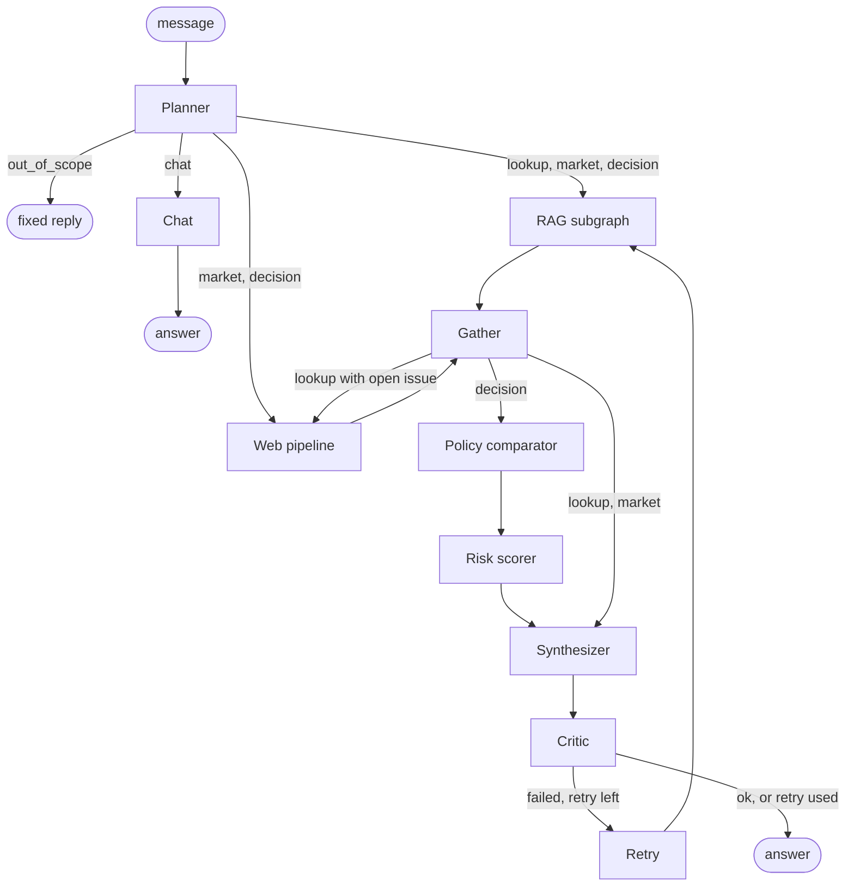
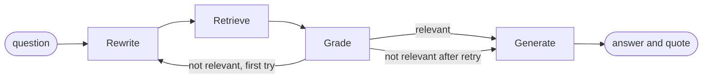

# Arla decision-support agent: project description and design decisions

An agentic RAG chat assistant built with LangGraph. It helps a new employee at Arla Foods (a farmer-owned dairy cooperative) understand how the company has acted before, what is happening in the market now, and whether a proposed decision is consistent with company policy and how risky it is. It remembers the conversation, so follow-up questions work.

Everything runs locally: an open-source LLM served by LM Studio, local embeddings, a local vector store, and a local sentiment model. No paid APIs are used.

**Document status (31 October 2026).** The system, its evaluations, the load test and the Docker setup are finished and were measured on the final agent. `README.md` is the short version of this document.

---

## Contents

1. [Problem and objectives](#1-problem-and-objectives)
2. [Task requirements and where they are met](#2-task-requirements-and-where-they-are-met)
3. [System architecture](#3-system-architecture)
4. [Data](#4-data)
5. [RAG subsystem](#5-rag-subsystem)
6. [News pipeline (the non-retrieval tool)](#6-news-pipeline-the-non-retrieval-tool)
7. [Policy comparator](#7-policy-comparator)
8. [Risk scorer](#8-risk-scorer)
9. [The agent](#9-the-agent)
10. [LLM choice and trade-offs](#10-llm-choice-and-trade-offs)
11. [User interface](#11-user-interface)
12. [Evaluation](#12-evaluation)
13. [Performance analysis](#13-performance-analysis)
14. [Engineering log: problems found and how they were fixed](#14-engineering-log-problems-found-and-how-they-were-fixed)
15. [Known limitations and future work](#15-known-limitations-and-future-work)
16. [Repository layout](#16-repository-layout)
17. [Setup and run](#17-setup-and-run)
18. [Docker](#18-docker)
19. [Configuration reference](#19-configuration-reference)

---

## 1. Problem and objectives

### The use case

A new employee at Arla needs to make or support decisions without years of institutional memory. Typical questions fall into three kinds:

| Kind | Example | What is needed |
|---|---|---|
| **Lookup** | "What was Arla's revenue in 2024?" | An exact, cited fact from internal documents |
| **Context** | "What is the latest news about Arla?" | Internal history plus what is happening in the market now |
| **Decision** | "Should we accept a EUR 300 gift voucher from a supplier during an ongoing tender?" | A check against company policy and an overall risk assessment |

### Why the problem is relevant

- Arla publishes a large body of governing documents (annual reports, codes of conduct, supplier code, anti-bribery and human rights policies, modern slavery statements, articles of association). Finding the right passage by hand is slow, and the same policy exists in several yearly versions.
- Market conditions change faster than documents do. A decision that is policy-consistent can still be risky because of a product recall or a price war that is in the news this week.
- A wrong answer has a cost. A wrong policy answer can mean a compliance breach, so answers must be cited and checkable.

### User needs addressed

1. **Fast, cited answers** from internal documents, with the exact supporting passage shown.
2. **Currency**: warnings when the best source may be superseded by a newer version, and a market view from recent news.
3. **A structured second opinion on a proposed action**: a policy verdict with citations, plus a transparent risk score with drivers and mitigations.
4. **Honesty about uncertainty**: the system says "I could not find this" instead of guessing, and flags answers the critic could not verify.

### Why an agentic RAG approach

A plain RAG pipeline (retrieve, then answer) cannot do the following, and each is a real requirement here:

| Requirement | Why plain RAG fails | What the agent does |
|---|---|---|
| Different questions need different tools | Lookups need documents only. Decisions need policy checks, risk scoring and news. | A planner routes by intent; the risk and policy tools run only for decisions. |
| Compound questions ("compare 2023 and 2024") | One query with one year filter cannot retrieve both years. | The planner splits the question; sub-questions run in parallel through the RAG subgraph. |
| Evidence can be missing or stale | Plain RAG answers anyway. | Grading, a retry with different keywords, a superseded-version warning, and an escalation to news when the evidence says something is still pending. |
| Hallucinated numbers | Plain RAG has no check. | A critic verifies citations, figures and a verbatim quote, and triggers one retry. |
| Time-sensitive context | Documents are static. | A separate news tool with sentiment and event flags. |
| Follow-up questions | Each question stands alone, so "and in 2023?" means nothing. | The planner rewrites a follow-up into a standalone question using the last few exchanges. |
| Questions about the conversation or the assistant | A document search finds nothing useful. | A chat intent answers from the conversation and a short fact sheet, with no search. |

---

## 2. Task requirements and where they are met

| Requirement from the brief | Status | Where |
|---|---|---|
| Real-world problem, with justification (relevance, user needs, why agentic RAG) | Done | Section 1 |
| LangGraph workflow with at least 5 nodes | Done | `agent/graph.py` registers 10 nodes: planner, rag, web, chat, gather, policy, risk, synthesize, critic, retry. Seven do real work: planner, web, chat, policy, risk, synthesize, critic. |
| Autonomous decision-making (conditional routing) | Done | Intent routing, early exit, chat shortcut, lookup escalation to news, critic retry (section 9) |
| Decomposition into subtasks with independent execution | Done | Fixed fan-out (RAG and news in parallel) and dynamic question splitting with LangGraph `Send` |
| State management for intermediate results | Done | `AgentState` (section 3.3) |
| At least 2 tools, one not purely retrieval | Done | RAG (retrieval); news pipeline with sentiment; policy comparator; risk scorer |
| Dedicated, modular RAG subgraph, not counted in the node total | Done | `rag/graph.py`, invoked from the agent through a wrapper node |
| Freely chosen text data source, focus on processing quality | Done | 22 Arla PDFs, quality-checked, cleaned, manifest-driven (section 4) |
| Open-source LLM, justified, no paid APIs | Done | Gemma (E4B) via LM Studio (section 10); a dummy LLM fallback exists |
| Streamlit prototype UI showing key steps and RAG output | Done | `app.py`: a chat with the route, RAG chunks, news and policy/risk tabs (section 11) |
| Dockerfile (mandatory), docker-compose (advantage) | Done | Section 18 |
| Mini evaluation set of 10-20 questions | Done | 20 end-to-end cases, plus 20 retrieval questions and 12 policy cases (section 12) |
| Load test of 50-200 queries with latency, bottleneck and 1-2 optimizations | Done | 100 queries with a dummy LLM, 12 with the real model, and an extrapolation to 50, 100 and 200 queries (section 13) |
| README with problem, architecture, evaluation and run instructions | Done | `README.md` |

---

## 3. System architecture

### 3.1 The agent graph



| Intent | Path |
|---|---|
| lookup | planner, RAG, gather, synthesizer, critic |
| market | planner, RAG and web in parallel, gather, synthesizer, critic |
| decision | planner, RAG and web in parallel, gather, policy comparator, risk scorer, synthesizer, critic |
| chat | planner, chat node (a question about the conversation or about the assistant itself) |
| out_of_scope | planner, fixed reply |

### 3.2 The RAG subgraph



### 3.3 State

The main graph shares one `AgentState` (a `TypedDict`). Parallel branches write different keys, and list keys use reducers so concurrent writes merge instead of overwriting.

| Key | Written by | Meaning |
|---|---|---|
| `question`, `history` | the caller | The newest message and the last few question and answer pairs of the chat |
| `question`, `intent`, `action`, `companies`, `subquestions` | planner | The planner overwrites `question` with the standalone version of a follow-up, and sets how it was classified and split |
| `rag_results` (list, reducer) | one entry per RAG run | Per sub-question: answer, quote, retrieved docs, relevance, attempts, and the retry round |
| `docs`, `rag_answer`, `quote`, `rag_relevant`, `rag_attempts` | gather | Merged RAG output for the current round, with citation numbers shifted so they stay unique |
| `news` | web | Per-company sentiment, events, headlines |
| `policy`, `risk` | policy, risk | Verdict with citations; level, scores, drivers, mitigations |
| `warnings` | gather | For example the superseded-version note |
| `answer`, `critic_ok`, `retries` | planner (out of scope), chat, synthesizer, critic, retry | Final text and loop control |
| `trace` (list, reducer), `timings` (list, reducer) | every node | The route taken and seconds per node; the UI displays both |

### 3.4 Where an LLM is used and where it is not

| Component | LLM? | Notes |
|---|---|---|
| Planner | One call per message | Classifies the intent, splits compound questions and, in a chat, rewrites a follow-up into a standalone question, all in one reply. Skipped when the first message of a chat is clearly a decision (rules, section 9.1). |
| RAG: rewrite | Yes | Returns a short search query and a year, as JSON. |
| RAG: retrieve | No | Embedding search with an optional year filter. |
| RAG: grade | Only when ambiguous | Retrieval distance decides the clear cases. |
| RAG: generate | Yes | Cited answer plus a verbatim supporting quote. |
| News pipeline | No LLM | Local FinBERT sentiment and rule-based event flags. |
| Policy comparator | One call | Chooses one of three labels; everything around it is validated by rules. |
| Risk scorer | No | Fully rule-based and testable. |
| Synthesizer | One call | Writes a short answer paragraph. Verdicts, risk, headlines and sources are assembled by code. |
| Chat node | One call | Answers from the conversation and a short fact sheet, with no retrieval. |
| Critic | No | Rule-based checks. |

The principle: use the LLM for language, and use deterministic code for anything that has to be right (verdicts are validated, the risk level cannot be changed by the model, figures are checked against sources, and clear decision phrasing is recognised by rules because the small model was unreliable at it).

---

## 4. Data

### 4.1 Internal corpus

22 public Arla PDFs, 2,953,580 readable characters in total.

| Document type | Files |
|---|---|
| Annual reports | 2020, 2021, 2022, 2023, 2024, and the abridged 2025 report |
| Half-year report | H1 2026 (includes the merger with DMK on 1 June 2026) |
| Code of Conduct | Arla Code of Conduct ("Our Responsibility") |
| Supplier Code | Code of Conduct for Suppliers and Business Partners, v3.0 |
| Anti-bribery policy | External anti-bribery policy |
| Human rights policy | Reviewed April 2025 |
| Modern slavery statements | 2021, 2022, 2023, 2024 |
| Responsible sourcing | February 2021 |
| UK tax strategy | Financial year 2022 |
| Articles of association | October 2023 |
| Financing framework | Sustainable financing framework, February 2020 |
| Animal welfare | BBFAW 2025 report |
| Farm programme | Arlagården catalogue v2.1 |
| German supply-chain act | Policy statement for Arla Foods Deutschland |

### 4.2 Manifest-driven metadata

`corpus/manifest.csv` is the single source of truth for document metadata:

| Column | Purpose |
|---|---|
| `doc_id` | Stable identifier, used by the evaluation sets |
| `file` | PDF file name, stored as `source` in the index |
| `title` | Human-readable title shown in citations |
| `doc_type` | Used by the policy comparator's fixed filter and by the superseded check |
| `year` | Used for the year filter and to find the newest version of a policy |
| `url` | Where the PDF came from (for reproducibility) |

`make_manifest.py` generates a first draft from file names, and the draft is then corrected by hand. I originally derived `doc_type` and `year` from file names with regular expressions, but this produced wrong or missing years for several files, so metadata became explicit and reviewable. One policy (the anti-bribery policy) has no date in the PDF; its year is 0 in the manifest and citations therefore use the title, not the id.

### 4.3 Text quality check

Extraction uses `pypdf`, page by page, so every chunk keeps an exact page number for citations. `check_pdf_quality.py` goes beyond counting characters:

| Check | Why it matters |
|---|---|
| Broken glyphs (`(cid:123)`, `U+FFFD`, private-use characters, mojibake) | Extraction failed for that font; text would embed poorly |
| Letter ratio and empty pages | Detects garbage or scanned pages |
| Spaced-out letters ("A R L A") | Breaks keyword matching |
| Ligatures (`fi`, `fl`) | Look right on screen but do not match "fi" or "fl" in search |
| Hyphen line breaks (`sustain-` / `able`) | Splits words inside chunks |
| Repeated lines across pages | Headers and footers become noise inside many chunks |

**Result:** all 22 PDFs were clean. Broken characters: 0 in every file. Letter ratio 86-97%. The three large annual reports had 1,300-1,470 hyphen breaks each, the 2020 report had 16 repeated header/footer lines, and ligatures and spaced letters were negligible (a handful in the 2020-2023 reports). Empty pages (3-6% in the older reports) are photo or divider pages.

### 4.4 Cleaning (`rag/cleaning.py`)

1. Unicode NFKC normalisation (turns ligatures into plain letters, `CO₂` into `CO2`).
2. Remove lines of 3-80 characters that appear on more than 40% of a document's pages (headers and footers), for documents with at least 5 pages.
3. Rejoin words split by a hyphen at a line break when the next letter is lowercase.
4. Collapse whitespace; drop pages shorter than 100 characters.

Known trade-off: a genuine compound split across lines (for example "farmer-" / "owned") becomes "farmerowned". These cases are rare and barely affect retrieval.

### 4.5 Known data limitation

Financial tables extract as bare number sequences with no row structure ("Revenue 13,770 13,674 13,793..."). This is a limitation of text extraction. It is why numeric questions are the weakest category and why the answer prompt demands a scope statement and a verbatim quote.

---

## 5. RAG subsystem

### 5.1 Chunking: two strategies compared

Both strategies chunk **per page**, so page numbers stay exact. The trade-off is that a passage spanning two pages is split.

| Strategy | Parameters | Idea |
|---|---|---|
| **recursive** | 800 characters, 150 overlap, `RecursiveCharacterTextSplitter` | Baseline. The embedded chunk is the chunk returned. |
| **parent-child** | Parent: 1,500 / 200 overlap. Child: 300 / 50 overlap. | Embed small children for precise matching, but return the larger parent as context. The parent text is stored in the child's metadata. |

Both build into separate Chroma collections from the same loader (`python ingest.py` builds both; `--strategy` builds one). Parent-child results are deduplicated by parent text, so two children of the same parent do not return the same context twice.

### 5.2 Embeddings and vector store

| Choice | Value | Reason |
|---|---|---|
| Embedding model | `BAAI/bge-small-en-v1.5` | Small (about 130 MB), runs locally on CPU, good retrieval quality for its size |
| Normalisation and metric | Normalised embeddings, cosine distance | Distances are comparable and bounded, which the grading thresholds rely on |
| Vector store | Chroma, persistent local folder | No server or API key; supports metadata filters (year, document type) that FAISS does not offer as simply |

### 5.3 Retrieval (`rag/retrieval.py`)

- Fetches twice the requested number of results, deduplicates, and returns the top k (default 5).
- Optional filters: `year` (exact), `doc_type` (a single value or a list, using Chroma's `$in`).
- Each result carries the parent text (`text`), the matched child (`match`), distance, and the manifest metadata.

### 5.4 The subgraph in detail

| Node | Behaviour |
|---|---|
| **Rewrite** | An LLM call returns JSON with a short `query` and the `year` if the question names one. (The prompt does not ask for a document type; see 5.5.) On a retry it is told the previous query failed and to use different keywords, and the year filter is dropped. |
| **Retrieve** | Vector search with the year filter. |
| **Grade** | Rules first, LLM only when ambiguous: best distance ≤ 0.30 means relevant; above 0.45 means not relevant; in between, one LLM call decides. |
| **Generate** | Builds the prompt from the retrieved chunks, within a 6,000-character budget (see 5.6), and asks the model to cite sources `[n]`, state what each figure refers to (whole company or segment, and which year), and finish with a verbatim `Quote:` line. If there is no relevant evidence, it returns "I could not find this in the Arla documents." |
| **Routing** | If grading fails, the subgraph rewrites once more and tries again. After the second failure it goes to generate, which reports no evidence. |

The subgraph is built by `build_rag_graph(strategy, k, use_rewrite, use_grade)`. The switches exist so that ablations can be run (for example answer correctness with and without grading).

### 5.5 Retrieval experiments

The retrieval evaluation set (`eval/questions.csv`) has 20 questions, each with an expected source file, accepted pages, and a keyword that must appear on the page (all verified against the PDF text). Types: 10 `policy`, 4 `multi_year` (the same fact in different yearly documents), 6 `numeric` (figures from reports).

- **hit@k**: one of the top k results is from the expected file and an accepted page.
- **MRR**: mean reciprocal rank of the first such result.
- **kw@5**: the expected keyword appears in any of the top 5 results (a looser check that is independent of page labels).

Five query modes were compared on both chunking strategies (`compare_retrieval.py`). The index holds 4,789 recursive chunks and 13,647 parent-child chunks.

| Mode | What goes into the search |
|---|---|
| `none` | The raw question |
| `query` | The LLM-rewritten query only |
| `year` | The raw question plus the year filter |
| `qyear` | The rewritten query plus the year filter |
| `full` | The rewritten query, year filter and a `doc_type` filter chosen by the LLM |

The rewrites are cached in `eval/rewrites.json`, so every run (and the embedding model comparison below) sees identical queries and the table is reproducible. A different batch of LLM rewrites moved the best configuration's MRR by about 0.05 in an earlier run, so smaller differences are noise.

**Results (bge-small, top 5):**

| Strategy | Mode | hit@1 | hit@3 | hit@5 | MRR | kw@5 |
|---|---|---|---|---|---|---|
| recursive | none | 0.30 | 0.50 | 0.70 | 0.44 | 0.55 |
| recursive | query | 0.40 | 0.50 | 0.60 | 0.46 | 0.60 |
| recursive | year | 0.55 | 0.80 | 0.85 | 0.67 | 0.70 |
| recursive | qyear | 0.55 | 0.80 | 0.90 | 0.70 | 0.80 |
| recursive | full | 0.50 | 0.70 | 0.75 | 0.61 | 0.65 |
| parent | none | 0.50 | 0.60 | 0.60 | 0.54 | 0.60 |
| parent | query | 0.35 | 0.60 | 0.60 | 0.47 | 0.60 |
| parent | year | 0.65 | 0.80 | 0.85 | 0.72 | 0.80 |
| **parent** | **qyear** | **0.65** | **0.90** | **0.90** | **0.76** | **0.85** |
| parent | full | 0.55 | 0.75 | 0.75 | 0.64 | 0.70 |

Chosen configuration, by question type (hit@5 / MRR): policy 0.80 / 0.68, multi_year 1.00 / 0.71, numeric 1.00 / 0.92.

**Conclusions**

1. **The year filter is the largest single gain.** On numeric questions hit@5 rises from 0.33 to 0.83 (recursive) and from 0.50 to 1.00 (parent-child) when the year filter is added. On multi-year questions the parent-child hit@5 goes from 0.50 to 1.00. The LLM extracted every year that the questions named correctly.
2. **The `doc_type` filter hurts.** The model's document-type guess was wrong for several questions (for example the gift-register question was filed under "code of conduct", though it lives in the anti-bribery policy). A hard filter turns a wrong guess into a guaranteed miss: policy hit@5 falls from 0.80 to 0.50 (parent-child) and from 0.90 to 0.60 (recursive), so `full` is worse than `qyear` on both strategies. `doc_type` is therefore never used as an LLM-chosen filter, and the production rewrite prompt does not ask for it. The policy comparator uses a fixed list of policy document types set in code instead.
3. **A short rewritten query helps policy questions** (recursive policy hit@5 reaches 0.90 in `query` mode), but without the year filter it loses the year and hurts multi-year questions (recursive multi_year hit@5 falls from 1.00 to 0.50), which is why combining it with the year filter (`qyear`) is best.
4. **Parent-child ranks better than recursive** in the strongest configuration (hit@1 0.65 against 0.55, MRR 0.76 against 0.70). At hit@5 both reach 0.90.
5. **Caveat:** with 20 questions, one question is 5 points and the 95% confidence interval on a score of 0.80 is about +-0.18. The large effects (the year filter, the harmful `doc_type` filter) are trustworthy; small differences between strategies are not.
6. **The two misses in the chosen configuration** are the facilitation-payments question (a policy phrasing) and "What share of Arla's group revenue does the UK contribute?", where the gold page is in the 2022 UK tax strategy but the system correctly retrieves a newer annual report (a label issue, see section 12.4).

**Chosen configuration:** parent-child chunks with the rewritten query and the year filter.

**Embedding model comparison.** `bge-base-en-v1.5` (768 dimensions, three times the size of `bge-small`) was compared on the same cached rewrites (`eval/embedding_comparison.md`). In the chosen configuration both reach MRR 0.76: `bge-base` gains one question at hit@5 and loses one at hit@1, and is slightly worse on the recursive baseline. Retrieval takes about 25 ms per query against 15 ms. The difference is within noise, so `bge-small` stays; the grading thresholds (0.30, 0.45) and the policy limit (0.35) were also tuned on its distances.

**An evaluation lesson.** The first run showed numeric questions at 0.17. Inspecting the misses showed that facts such as "2024 revenue 13,770" appear on 4-5 pages of the same report (for example the income statement and the notes). My gold pages were too narrow. After widening them to every page that states the figure (each verified in the PDF text), numeric hit@5 rose to 1.00. What looked like a retrieval problem was a labelling problem.

### 5.6 Prompt budget

The first full evaluation run crashed with an HTTP 400 from LM Studio during answer generation. The cause was most likely context overflow: the critic's retry uses 8 chunks, and 8 parent chunks of up to 1,500 characters (table-heavy text) can exceed a 4,096-token context window. Two measures were added:

- The prompt context is capped at 6,000 characters in total, split evenly across chunks. A chunk that is too long is cut to a window **around the matched child passage**, not its first characters, so the relevant row survives.
- LLM errors now carry the server's response body and the prompt size instead of a bare 400.

It is also recommended to set LM Studio's context length to 8,192 or more.

---

## 6. News pipeline (the non-retrieval tool)

`news/` fetches, cleans, scores and aggregates recent headlines. It produces numbers and a signal, not passages, which makes it the tool that is "not purely retrieval-based".

### 6.1 Data

Google News RSS for four companies (Arla, Lactalis, FrieslandCampina, Danone), 30-day window. A dated snapshot (`snapshots/news_snapshot_20261030.json`, fetched on 30 October 2026) is the default input so that the project is reproducible and works offline in a container. `live=True` tries a fresh fetch and falls back to the snapshot if that fails.

The snapshot contains 260 Google News items (Arla 68, Lactalis 42, FrieslandCampina 50, Danone 100), dated 1-29 October 2026. In 246 of 260 items the `text` field is just the headline plus the publisher, and the links are Google redirect URLs. **Article bodies are therefore not fetched, and sentiment is scored on headlines only.** (The snapshot also contains trade-press and GDELT items from the feasibility check; they are filtered out.)

### 6.2 Cleaning (`news/clean.py`)

| Step | Detail |
|---|---|
| Strip the publisher suffix | "Title - Publisher" becomes "Title" |
| Relevance | The company name must appear in the title |
| Time window | 30 days measured from the **fetch time**, so an old snapshot is not emptied by the passage of time |
| Near-duplicate merge | Fuzzy match (`rapidfuzz.token_set_ratio` ≥ 70) within a company. The earliest headline is kept and the number of outlets that carried the story is recorded. |
| Corporate-source flag | Items published by the company's own site are flagged and excluded from sentiment averages (self-published news is biased positive) |

The merge threshold was calibrated by inspection: at 85, one recall story survived as several separate items; at 70 the merged clusters were correct (for example one Arla climate-programme story from five outlets, one Lactalis CEO announcement from eight); at 65 unrelated stories started to merge (a Lactalis milk price cut with a milk price rise).

Result: Arla 68 raw items became 34 stories, Lactalis 42 became 22, FrieslandCampina 50 became 26, Danone 100 became 70.

### 6.3 Sentiment (`news/sentiment.py`)

`ProsusAI/finbert`, a finance-tuned classifier, runs locally. The score per headline is `P(positive) - P(negative)`, from -1 to +1. Scores are cached on disk, so each headline is scored once.

| Company | Stories | Rated | Avg sentiment | Negative share | Event stories |
|---|---|---|---|---|---|
| Arla | 34 | 32 | +0.18 | 22% | 10 |
| Lactalis | 22 | 22 | +0.12 | 14% | 2 |
| FrieslandCampina | 26 | 26 | +0.37 | 8% | 0 |
| Danone | 70 | 69 | +0.35 | 9% | 0 |

The most negative headlines were the ones one would expect (the glass-fragment pudding recalls, Arla Sweden ending contracts with 52 farms, Lactalis milk price cuts), which supports using FinBERT here. Its limits are documented in 6.5.

### 6.4 Event flags (`news/events.py`)

Rule-based categories applied to each headline: `recall`, `contamination`, `price_cut`, `labour`, `legal`, `disruption`. They are more reliable than sentiment for risk purposes ("recall" is unambiguous even when the sentiment score is mild). The 10 Arla event stories are mostly variants of one recall.

### 6.5 Limitations

- FinBERT measures **financial tone, not risk to Arla**. "Lactalis raises milk price" scored negative, although it is good news for farmers. A competitor's bad news is not good news for Arla; it is market context.
- Some items are stock-exchange reports about locally listed subsidiaries (for example Nigerian or Pakistani exchange news about FrieslandCampina) and are noise for this use case.
- The same incident reported in different words can still count as several event stories.
- The snapshot is a point-in-time dataset (30 October 2026).

---

## 7. Policy comparator

`tools/policy.py` answers "does the proposed action break Arla's own rules?" with `consistent`, `conflict` or `no_precedent`, plus the policies that support the verdict.

| Step | Type | Detail |
|---|---|---|
| 1. Retrieve | rule | Vector search on the action, restricted to a **fixed list of policy document types** (anti-bribery, code of conduct, supplier code, human rights, responsible sourcing, modern slavery, policy statement, tax strategy, animal welfare, articles of association). The list is set in code, not guessed by the LLM. |
| 2. Filter | rule | Keep only the newest year per document type; drop passages with cosine distance above 0.35. |
| 3. Short-circuit | rule | If nothing remains, return `no_precedent` without an LLM call. |
| 4. Judge | **LLM, one call** | Gemma returns JSON: verdict, supporting passage numbers, one-sentence reason (temperature 0). |
| 5. Validate | rule | The verdict must be one of the three labels and the cited numbers must exist. A `conflict` or `consistent` verdict with no valid citation is downgraded to `no_precedent`. Duplicate citations (two chunks from the same page) are merged. |

The design lets a small model make a narrow, checkable choice, and ensures a verdict is never reported without a citation.

**Evaluation** (`eval/policy_cases.csv`, `eval_policy.py`): 12 proposed actions with expected verdicts (examples: a voucher during a tender, facilitation payments, political donations, a recruitment fee charged to workers, a 55-hour working week, 16-year-olds on night shifts, routing profit through a tax haven, uncertified palm oil, a normal EUR 80 business lunch, choosing packaging colours).

**Result (re-run on the final code): 12/12 correct verdicts, and the expected policy document was cited in 10/10 cases that have one.**

One caveat: the verdict can depend on the wording. "Move the company headquarters to another Danish city" gets `no_precedent` here, which is the label in this set. The same scenario phrased as "Should we move the company headquarters to another Danish city?" got `conflict` in the end-to-end evaluation (section 12.4), citing Article 1.3 of the Articles of Association (the registered office is in Aarhus). `conflict` is the more defensible answer, so the label in this set is probably too lenient. It has not been changed.

---

## 8. Risk scorer

`tools/risk.py` is a pure function with no LLM. It turns four dimensions into a level with drivers and mitigations. All weights, thresholds and keyword tables are in `config/risk.json`.

### 8.1 Dimensions (0-100 each, higher is riskier)

| Dimension | Weight | How it is scored |
|---|---|---|
| **Policy** | 0.40 | `conflict` 90, `no_precedent` 50, `consistent` 10 |
| **Regulatory** | 0.20 | Keywords in the action, or matched policy types, map to regulated areas: bribery 40, human rights and supply chain 35, sanctions 40, food safety 30, competition 25, sourcing 25, tax 20, data privacy 20. The score is the sum, capped at 100. |
| **External** | 0.20 | `100 × (0.4 × negative_share + 0.6 × event_share)`. `negative_share` blends Arla's share of negative headlines (70%) with rivals' (30%). `event_share` is the number of **relevant** Arla event stories divided by 3, capped at 1. Unavailable news gives a neutral 50 and a flag. |
| **Evidence confidence** | 0.20 | Penalties that add up (capped at 100): weak best match above distance 0.30 (+30), fewer than 3 passages (+20), graded not relevant (+30), needed a retry (+10). |

**Relevant events.** An event story counts only if its type matches one of the action's regulated areas (a recall matches food safety), or its headline shares at least two content words with the action. This was added after the first end-to-end run, when the external score was identical for every decision, driven by an unrelated product recall.

### 8.2 Level, floor and flags

- Total = weighted sum. Below 35 is LOW, below 65 is MEDIUM, 65 or above is HIGH.
- **Hard floor:** a `conflict` with an anti-bribery, human rights, supplier-code or modern-slavery policy is never below MEDIUM, whatever the other dimensions say.
- **Drivers:** the top three dimensions with a score of at least 25, each as a plain sentence, for example "Policy verdict: conflict (Anti-bribery policy, p.5)".
- **Mitigations:** looked up from a table keyed by driver (for example "Do not proceed until Legal and Compliance have reviewed the conflicting policy.").
- **`needs_more_evidence`:** set when the level is HIGH and the evidence dimension is 50 or more. The critic uses it to trigger a retry.

### 8.3 Example (measured)

"Accept a EUR 300 gift voucher from a supplier during an ongoing tender": policy 90, regulatory 40, external 7, evidence 0, total 45.5, level MEDIUM, with the anti-bribery conflict as the top driver.

### 8.4 Testing

12 unit tests (`tests/test_risk.py`): weights sum to 1; a calm consistent case is LOW; a conflict with weak evidence and bad news is HIGH; the hard floor lifts a low total to MEDIUM; `no_precedent` is not floored; level thresholds at their boundaries; missing news is neutral and flagged; changing a weight changes the total; the regulatory score is capped; drivers are sorted with mitigations; unrelated events do not raise the external score; headline word overlap makes an event relevant.

### 8.5 Honest framing

The weights are expert-set heuristics, not learned. The scorer is a transparent decision aid, not a prediction. With the starting weights, a clear bribery conflict lands at MEDIUM (about 45-47) rather than HIGH. If conflicts should be HIGH, the simplest change is raising the hard-floor level for anti-bribery. This is intentionally left as a tuning decision.

---

## 9. The agent

### 9.1 Planner (`agent/planner.py`)

One LLM call per message returns JSON with the intent, an optional list of sub-questions and, when there is a chat history, a standalone rewrite of the message.

| Intent | Meaning |
|---|---|
| lookup | What Arla's documents say, or what Arla did in the past |
| market | Recent news or sentiment about Arla or its competitors, possibly with Arla's history |
| decision | Whether Arla should or can do something that is proposed |
| chat | A question about the conversation itself ("what was my last question?") or about the assistant ("what can you do?", "who are the competitors?") |
| out_of_scope | Clearly unrelated to Arla, dairy or the food business. The prompt says to use it only when sure. |

The prompt also contains a short fact line (which competitors the assistant tracks), so a question about them can be answered without searching.

Invalid or unparseable output falls back to `lookup`, never to `out_of_scope`, so a parsing failure cannot silently refuse a real question.

**Rules for decisions.** An early version let the LLM classify everything. In the first end-to-end run, none of the five decision questions was routed as a decision (the model chose `lookup`), so the policy comparator and the risk scorer never ran. Rewording the prompt did not fix it. Clear decision phrasing is therefore recognised by a regular expression: "should/shall we", "can/could/may/might we", "is it / would it be OK, acceptable, allowed, a problem", "we are considering / planning", "we plan / propose / intend / want to". On the first message of a chat a match skips the LLM call completely. In a chat the LLM still runs (to rewrite the follow-up), and the rule is applied to the rewritten question afterwards. Everything not matched by a rule is still classified by the LLM. In a chat, if the LLM answers `chat`, the rule does not override it.

**Splitting.** For lookup and market questions, the LLM may return 2 or 3 self-contained sub-questions (for example one per year in a comparison). Anything else, including a single sub-question, falls back to the original question. Decisions are never split. Duplicates are removed and the list is capped at three.

**Companies.** The planner extracts the companies named in the question. If none is named, it uses all four. A question that mentions competitors, rivals, competition or peers also uses all four, because "Arla's competitors" names only Arla but needs the rivals' news.

### 9.2 Parallel execution

- The planner's routing function returns one RAG task per sub-question (LangGraph `Send`) plus the web node for market and decision intents. These run in the same step, concurrently.
- `gather` is the join. It merges the current round's RAG results, shifting citation numbers by the number of documents already merged so that `[1]` in the second sub-answer becomes `[3]` if the first sub-answer had two documents.
- Retries use a `round` number on each result, so a retry's results replace the earlier ones without any reset logic.

### 9.3 Autonomous decisions

| Decision | Trigger | Action |
|---|---|---|
| Route by intent | Planner (rules first, then the LLM) | Skips the policy and risk tools for lookups and market questions |
| Stop early | `out_of_scope` | Fixed reply, no search, no news, no critic |
| Answer from the conversation | `chat` | One LLM call, no search (section 9.6) |
| Split a compound question | The planner returns 2-3 sub-questions | Parallel RAG per sub-question |
| Superseded-version warning | The top source is a policy document older than the newest one of its type | Adds a note to the answer (no extra tool call) |
| Escalate a lookup to news | The answer or quote contains "pending", "expected to", "planned", "not yet", and similar | Runs the news branch and appends a market section |
| Retry | The critic rejects the answer | Re-runs RAG with 8 chunks instead of 5 (and a wider policy retrieval), once |

The escalation trigger was changed during development. The first version escalated when RAG found nothing relevant, but if the documents do not contain the answer the news rarely will, so it only added an unrelated section. The current trigger fires on evidence that describes something still open (for example the 2025 report saying the DMK merger is "pending").

### 9.4 Synthesizer

Code assembles every factual section, and the LLM writes only a short paragraph.

- **Single-question lookup:** the cited answer, the supporting quote (shown as "Evidence"), and a source list. Pages that were retrieved several times are grouped (for example `[1][4] ... p.117`). No extra LLM call is made.
- **Market, compound lookups and decisions:** a short answer paragraph (one call), then the internal evidence, the market section and the sources. For a decision the policy check and the risk assessment (level, dimension scores, drivers, mitigations) come before the evidence.
- **The paragraph prompt** tells the model to answer the question first and, if the internal evidence does not contain the answer, to use the market data, which names the companies that are tracked. The facts given to it include an explicit list of those companies.

Because verdicts and risk levels are inserted by code, the model cannot turn a HIGH into a LOW.

### 9.5 Critic (`agent/nodes.py`)

Rule-based, so it adds no LLM latency. For each RAG result it checks:

1. The answer has at least one `[n]` citation, and each cited number exists.
2. Every figure in the answer (excluding figures from the question) appears in the **cited** passages, not merely somewhere in the evidence.
3. A supporting quote exists and matches the cited passages (fuzzy match, `rapidfuzz.partial_ratio` >= 85, tolerant of spacing and case).
4. The risk scorer has not flagged "high risk with weak evidence".

**Exception.** If news is available and the RAG answer says the documents do not contain the answer ("the context does not provide ...", "could not find ...") or was graded not relevant, checks 1-3 are skipped for that result. There is nothing in the documents to cite, and the market data carries the answer. Without this rule, every market question whose documents had nothing to say failed the critic and ran RAG twice.

On failure the graph retries once. If the retry also fails, the answer is returned with a visible warning ("this answer could not be fully verified: ...") instead of silently.

**What the critic can and cannot do.** It proves that a figure and a quote exist in the cited source. It cannot prove that the figure answers the question. In the final evaluation, one comparison answered with a wrong half-year figure that the critic did not flag (section 12.4). The scope-statement and quote requirements in the prompt, and the visible "Evidence" line, exist to make such cases visible to the reader. It is also slightly strict on compound answers: when the model leaves the `[n]` marks out of one sub-answer, the whole answer is flagged even if the content is right.

### 9.6 Conversation memory and the chat node

The chat history lives in the UI (`st.session_state`), not in the graph. For each new message the UI passes the last four question and answer pairs (`agent/memory.py`). Each answer is shortened first: the source list, headings and warning lines are removed and the text is cut to 600 characters at a word boundary. This keeps the planner prompt to about 2,500 characters of history.

- **Follow-ups.** The planner rewrites the message into a standalone question ("and in 2023?" becomes "What was Arla's revenue in 2023?"). Everything after the planner uses the rewritten question. The route shows it as `planner: lookup, asked as '...'`.
- **Questions about the conversation or the assistant.** The planner sends them to the `chat` node, which makes one LLM call with the history and a fact sheet (what the assistant can do, which competitors it tracks). It does no retrieval and has no critic. A `chat` message is never rewritten, so "what was my last question?" reaches the node as typed.
- **Reset.** The "New chat" button clears the history.

---

## 10. LLM choice and trade-offs

| Item | Choice |
|---|---|
| Model | `google/gemma-4-e4b` in LM Studio (as I understand the naming, a small "effective 4B parameter" model) |
| Interface | LM Studio's OpenAI-compatible server (`http://localhost:1234/v1`), called through `langchain-openai` with a dummy API key. Settings: `LLM_BASE_URL`, `LLM_MODEL`. |
| Fallback | `LLM_BACKEND=dummy` returns canned replies so the pipeline and UI can run without an LLM |
| Temperature | 0 (deterministic, repeatable evaluation) |

**Why a small local model:** the brief forbids paid APIs, the model fits ordinary local hardware, and every use of the LLM in this system is a narrow task (short JSON, a three-way label, a cited answer from supplied passages) where a small model is adequate.

**Trade-offs, measured on the development machine (with a small script that has since been removed; see git history):**

| Measurement | Result |
|---|---|
| Short prompt, 5 tokens out | 0.9 s |
| 1,000-token prompt, 5 tokens out | 2.3 s (about 435 prompt tokens/s) |
| 3,000-token prompt, 5 tokens out | 4.7 s (about 630 prompt tokens/s) |
| Generation | about 15 tokens/s |

Reading the prompt is fast. **Generating is slow, so cost is driven by the number of output tokens.** The load test (section 13) shows the same pattern: a rewrite call returns about 350 tokens and a planner call about 460 on average, for replies that need about 30 tokens of JSON. This suggests the model produces reasoning tokens that are not shown. I have not verified this.

**Design responses to a small model:**

- Constrained outputs (JSON, a fixed label set) that are validated by code.
- Rules decide wherever they can (planner, grading, risk scorer, critic).
- A prompt budget to stay inside the context window.
- Requirements in the prompt (scope, verbatim quote) that the critic can check.

**Requirement:** set the model's context length to 8,192 or more in LM Studio.

---

## 11. User interface

`app.py` (Streamlit) is a chat that shows the agent working and the output of each stage. It has two tabs.

**Info tab.** A short description of the use case, a table of the five intents with an example each, the agent graph, and a list of the building blocks. The graph is drawn from Python data (a node list and an edge list in `app.py`) with `st.graphviz_chart`. Blue boxes use the LLM, grey boxes are rules or code, and dashed arrows loop back. If the agent graph changes, those two lists must be edited too.

**Ask a question tab.**

- **Chat:** a message box at the bottom of the page and the conversation above it. The agent remembers the last four exchanges, so follow-ups work (section 9.6).
- **Examples:** four buttons (Lookup, Compare, Market, Decision) send a ready-made question. Hovering shows the full text.
- **Conversation banner:** once a chat has started, a banner says how many questions the agent remembers and invites a follow-up. A "New chat" button next to it clears the memory.
- **While running:** a live status box lists each node's trace lines as the graph streams updates (`stream_mode=["updates", "values"]`), so the parallel RAG and news branches are visible as they finish.
- **Newest answer:** metrics for the intent, total time, number of LLM calls and whether the critic verified the answer; the cited answer with its "Evidence" quote and sources; and these detail tabs:
  - **Agent route:** the full trace, seconds per node, and LLM usage per task (calls, seconds, tokens in and out).
  - **RAG output** (when RAG ran): each sub-question with its answer and quote, then every retrieved chunk with its distance, the matched passage, and the parent chunk used as context.
  - **Market news** (when news was fetched): per-company stories, sentiment and events, and Arla headlines with links.
  - **Policy and risk** (decisions): the verdict, risk level and score, a chart of dimension scores, drivers, mitigations, and the cited policy passages.
- **Older answers** show only the text and a one-line caption (intent and seconds), which keeps a long chat short.
- **Sidebar:** the model, the server address and the index details.

The model and graph load once and are cached. A failure (for example LM Studio not running) shows an error message instead of crashing, and the failed message is not added to the memory.

The UI was tested with Streamlit's `AppTest` (including example buttons, a follow-up and "New chat" with the dummy LLM) and used by the developer with the real model, both locally and in the Docker container.

---

## 12. Evaluation

### 12.1 Summary

| Layer | Set | Result |
|---|---|---|
| Retrieval | 20 questions, ten configurations | Best: parent chunks, rewritten query and year filter: hit@5 0.90, MRR 0.76 (section 5.5) |
| Policy comparator | 12 proposed actions | 12/12 correct verdicts; the expected policy was cited in 10/10 cases that have one (section 7) |
| Risk scorer | 12 unit tests | All pass; behaviour examples in section 8 |
| Unit tests | 84 `pytest` tests | All pass: planner 43, critic 13, risk 12, chat 6, context 5, memory 5 |
| End to end | 20 cases | Routing 0.95, answer correctness 0.95, policy verdicts 5/5, critic verified 0.85 |

The unit tests stub the LLM, so they check the plumbing (routing rules, fallbacks, citation renumbering, the critic's checks, memory) and not answer quality. Answer quality is measured by the other layers.

### 12.2 Retrieval evaluation

See section 5.5.

### 12.3 Policy evaluation

See section 7.

### 12.4 End-to-end agent evaluation (`eval_agent.py`)

20 cases in `eval/agent_cases.csv`:

| Intent | Cases | Examples |
|---|---|---|
| lookup | 8 | 6 single facts (gift-register threshold, child-labour age, resignation notice, UK share of revenue, colleagues in 2023, who audits the Arlagården farms) and 2 compound questions (revenue 2023 vs 2024; performance price 2021 and H1 2026) |
| market | 4 | Latest news about Arla; Lactalis and Danone; Arla's protein pudding; who Arla's main competitors are |
| decision | 5 | Voucher during a tender; facilitation payment; an EUR 80 business lunch; moving the headquarters; a recruitment fee charged to workers (phrased as "We are considering ...") |
| out_of_scope | 3 | Pizza toppings; a poem about the sea; the capital of Australia |

Correctness is scored by keyword: `|` means any of, `&` means all of (for example `13,674|13.7&13,770|13.8` for a comparison question). Decision cases also check the policy verdict. Routing accuracy compares the planner's intent with the label.

**Results (final agent, real model):**

| Metric | Value |
|---|---|
| Routing accuracy | 0.95 (19/20) |
| Answer correctness | 0.95 (19/20) |
| Policy verdict accuracy | 1.00 (5/5 decisions) |
| Critic verified (no warning on the answer) | 0.85 (17/20) |

| Intent | Correct answers | Mean seconds | Mean LLM calls |
|---|---|---|---|
| lookup | 7/8 | 126 | 5.0 |
| market | 4/4 | 141 | 4.2 |
| decision | 5/5 | 176 | 5.4 |
| out_of_scope | 3/3 | 36 | 1.0 |

All five decisions were routed as decisions and got the correct verdict (`conflict` for the voucher, facilitation payment, headquarters and recruitment fee; `consistent` for the EUR 80 lunch). The three out-of-scope questions got the fixed reply after a single LLM call.

**The two misses**

1. *Performance price in 2021 and in the first half of 2026* (compound lookup). The answer states the 2021 figure correctly (39.7) but says the H1 2026 price "is projected to be 51.4 EUR-cent/kg"; the document says 43.6. This is a model error and the answer is wrong. The critic did not flag the figure, because it only proves that a number appears somewhere in the retrieved text. It flagged a missing citation in a sub-answer instead.
2. *Who are Arla's main competitors in the dairy market right now?* The planner routed it to `chat` while the label says `market`. The answer is correct ("Lactalis, FrieslandCampina, and Danone"), so this counts as a routing miss and a correct answer. The label was not changed. `chat` is arguably the better route, since the question asks for names the assistant already tracks.

**Critic.** Three answers carried a "could not be fully verified" warning: the facilitation-payment answer (no citations), the performance-price comparison (a sub-answer without citations) and the revenue comparison (a sub-answer without citations). Two of the three answers were correct; the critic is strict when the model leaves out the `[n]` marks.

**How the run was done.** The 20 results are in `eval/agent_results.csv`. They were collected in two sessions with the same agent behaviour: the second only added the code reorganisation described in section 14, which the tests cover. Each saved row has the answer text, the route taken, the time and the number of LLM calls.

**Labels that were corrected after seeing results (both verified against the PDFs):**

1. *"What share of Arla's group revenue does the UK contribute?"* The first gold answer, 26%, came from the 2022 UK tax strategy. The system answered 25% from the 2024 annual report (p.112: UK 3,492 of 13,770 = 25.4%), which is newer and correct for a question that names no year. The accepted answers are now 25 or 26.
2. *"Should we move the company headquarters to another Danish city?"* The label expected `no_precedent`. The comparator returns `conflict`, citing the Articles of Association. Article 1.3 says the registered office "shall be situated in the City of Aarhus, Denmark", so `conflict` is the defensible verdict. The expected verdict is now `conflict`.

The labels for the decision and market paraphrases were written by the developer and have not been reviewed by anyone else.

---

## 13. Performance analysis

### 13.1 Method (`load_test.py`)

A real-model run of 50-200 queries is not practical on one local model: at about two minutes per query it would take 2 to 7 hours. The load test is therefore split into three parts, and the split is part of the result.

| Run | Queries | LLM | Concurrency | What it measures |
|---|---|---|---|---|
| A. System overhead | 100, drawn from the 20 evaluation cases | Dummy (canned replies) | 1, then 8 | Everything except the LLM: retrieval, news, policy and risk logic, graph orchestration |
| B. Real-model sample | 12, three or four per route | Gemma 4 E4B in LM Studio | 1 | Latency per route, LLM calls, where the time goes |
| C. Extrapolation | 50, 100, 200 | none | none | Total time estimated from the per-route means of run B |

In run A the planner is stubbed to return each question's labelled intent (the dummy planner would otherwise say "lookup" for everything and the market and decision routes would never run), and the critic's retry is switched off (canned answers never pass the critic, so every query would run twice). The graph and the models are loaded once before timing; the cold start is reported separately.

### 13.2 Run A: system overhead (dummy LLM)

| Concurrency | Mean | p50 | p95 | Max | Throughput |
|---|---|---|---|---|---|
| 1 | 0.06 s | 0.04 s | 0.13 s | 0.37 s | 937 queries/min |
| 8 | 0.48 s | 0.41 s | 0.88 s | 1.24 s | 970 queries/min |

At concurrency 1, by route (mean): lookup 0.04 s, market 0.07 s, decision 0.14 s, out_of_scope under 0.01 s. All 100 queries were routed as labelled and none failed. The time is spread over RAG (64%), the policy comparator (19%) and the news branch (18%), which are all local retrieval and scoring work. Building the graph and loading the models takes about 8 s.

Eight parallel queries raise throughput by only 3%, while each query becomes about eight times slower. The work is limited by the CPU (embedding queries), not by waiting, so concurrency does not help the part of the system that is not the LLM either.

### 13.3 Run B: real model

12 queries in sequence, 0 errors, 25 minutes of wall time (0.5 queries per minute).

| Route | n | Mean | p50 | p95 | Retried |
|---|---|---|---|---|---|
| lookup | 4 | 127 s | 81 s | 238 s | 50% |
| market | 3 | 162 s | 142 s | 207 s | 0% |
| decision | 3 | 145 s | 155 s | 166 s | 0% |
| out_of_scope | 2 | 40 s | 25 s | 55 s | 0% |
| **all** | **12** | **126 s** | **129 s** | **238 s** | **17%** |

All 12 were routed to the expected route. A single-fact lookup took 60 to 130 s and the slowest query was the compound comparison (238 s, two RAG runs). Market and decision questions took 115 to 207 s.

Where the time goes, by LLM task (the two RAG runs of a compound question overlap, so these seconds add up to more than the wall time):

| Task | Calls | Total seconds | Seconds per call | Tokens out | Output speed |
|---|---|---|---|---|---|
| answer | 13 | 548 | 42 | 8,445 | 15.4 tok/s |
| rewrite | 16 | 340 | 21 | 5,633 | 16.6 tok/s |
| summary | 8 | 300 | 38 | 4,725 | 15.7 tok/s |
| plan | 9 | 254 | 28 | 4,143 | 16.3 tok/s |
| policy | 3 | 96 | 32 | 1,518 | 15.8 tok/s |
| grade | 3 | 93 | 31 | 1,556 | 16.7 tok/s |

By node: RAG 60% of node time, synthesize 18%, planner 16%, policy 6%. The news branch, gather, risk and critic together take well under a second. Only nine planner calls were needed for 12 queries, because the three decision questions were recognised by rule.

### 13.4 Run C: extrapolation

Using the per-route means of run B and the route mix of the evaluation set (lookup 40%, market 20%, decision 25%, out_of_scope 15%), the expected time is 126 s per query. Using the slowest query seen per route gives an upper bound of 186 s.

| Queries | Estimate (mean) | Upper bound |
|---|---|---|
| 50 | 1.7 hours | 2.6 hours |
| 100 | 3.5 hours | 5.2 hours |
| 200 | 7.0 hours | 10.3 hours |

Run B has only two to four queries per route, so this is an order of magnitude and not a precise figure. It also assumes the queries run one after another against one local model.

### 13.5 Bottleneck

**The LLM.** Without it the whole system adds well under a second per query (run A). With it, a query takes minutes, and the LLM calls account for essentially all of that time (the LLM seconds add up to 108% of the query time, because parallel calls overlap).

The underlying cause is generation speed: about 15 to 17 output tokens per second on this machine, for every task. Cost therefore follows the number of output tokens. Two tasks show that the model writes much more than the answer needs: a `rewrite` call returns on average 350 tokens for a reply that is about 30 tokens of JSON, and a `plan` call about 460. This suggests the model produces reasoning text that is not shown. I have not verified that.

Other observations:

- The planner costs about 28 s per message and runs for every message that is not clearly a decision. It is 16% of the total time.
- The critic's retry was the largest single avoidable cost earlier in development: a market or decision question that failed the critic ran RAG a second time. The exception for answers that rest on news (section 9.5) removed it.
- Concurrency does not help. One local model serves one request at a time, so concurrent users queue.

### 13.6 Optimization recommendations

These were identified from the measurements. Neither has been implemented.

1. **Limit the output of the short JSON tasks (rewrite, plan, grade).** They make up about 40% of the LLM time (687 of 1,631 s in run B). If the model stopped after the JSON, most of that time would go. The risk is that a hard token cap could cut off a reasoning reply and make the planner fall back to its default, so it should be tried against the evaluation set.
2. **Cache LLM replies.** Replies are deterministic at temperature 0, so a repeated prompt (the same question, the same rewrite) could be answered from a cache at no cost.

---

## 14. Engineering log: problems found and how they were fixed

This table records design changes that were driven by measurements.

| # | Finding | Evidence | Change |
|---|---|---|---|
| 1 | Filename-derived `doc_type` and `year` were unreliable | Several files got year 0 or a wrong year | Explicit `manifest.csv` as the single source of metadata |
| 2 | An LLM-chosen `doc_type` filter hurt retrieval | About 5 of 20 questions filtered to the wrong document type; `full` mode below `qyear` | `doc_type` is never an LLM-chosen filter; the policy comparator uses a fixed list in code |
| 3 | Gold labels for numeric questions were too narrow | The answer appeared on 4-5 pages; the system answered correctly from pages not in my list | Verified and widened accepted pages; reported both versions |
| 4 | The year filter was the biggest retrieval gain | Multi-year hit@5 from about 0.3-0.5 to 1.00 | Year extraction in the rewrite step is a hard filter |
| 5 | The LLM grader gave false negatives | A correct retrieval was graded "not relevant" twice, causing news escalation, a critic retry and 7 LLM calls (225 s) for a one-line lookup | Rule-based grading by distance first; the LLM only decides between 0.30 and 0.45 |
| 6 | The external risk score was the same for every decision | The voucher decision had an external score of 67, driven by an unrelated recall | Count only events relevant to the action (event type matches a regulated area, or headline shares content words) |
| 7 | Irrelevant mitigations shown | "News environment is sensitive" listed with zero relevant events | Drivers need a dimension score of at least 25 |
| 8 | A wrong figure passed the critic | A regional revenue figure was reported as group revenue; it was present in the cited page | Prompt requires scope, year and a verbatim quote; critic checks figures against the cited passages and the quote against the source; the quote is shown to the reader |
| 9 | Near-duplicate news stories inflated counts | One recall appeared as several stories | Similarity threshold calibrated from 85 down to 70 |
| 10 | Lookup escalation to news was weakly motivated | Nothing relevant in documents does not imply anything in the news | Escalate only when the evidence says something is still open |
| 11 | Fixed decomposition could not answer compound questions | One query has one year filter | Dynamic splitting with parallel `Send` fan-out and citation renumbering |
| 12 | HTTP 400 from LM Studio on a retry | 8 parent chunks can exceed a 4k-token context | 6,000-character prompt budget with a window around the matched passage; readable error messages |
| 13 | A single failing case stopped the whole evaluation | The traceback ended the run | The harness reports the failure and continues; results are saved per case so a rerun resumes |
| 14 | Two end-to-end gold labels were wrong | UK 25% vs 26%; registered office in Aarhus | Corrected after verifying against the PDFs; disclosed |
| 15 | The small LLM did not recognise proposed actions as decisions | In the first full evaluation none of the decision questions was routed as a decision, so no policy check or risk score was produced. Rewording the planner prompt did not fix it | Rules for clear decision phrasing, applied before the LLM (and again after a follow-up is rewritten); no planner call at all for a decision at the start of a chat |
| 16 | "Who are Arla's competitors?" fetched no competitor news | The question names only Arla, so the news step had only Arla's stories and the answer said the documents name no competitors | Competitor, rival and peer words select all four companies; the answer paragraph is told to use the market data when the documents have nothing |
| 17 | The critic made market and decision questions run RAG twice | When the documents have nothing to say, the RAG answer has no citations and fails the checks, which triggered a retry on nearly every such question in the load test | Skip the citation and quote checks when news is available and the RAG answer says it found nothing |
| 18 | Follow-up questions did not work, and "what was my last question?" ran a document search | Each message was independent, and the search found nothing | Chat history, a standalone rewrite in the planner, and a `chat` intent (section 9.6) |
| 19 | The repository only worked from its root folder and wasted start-up time | Paths were relative to the working directory, the embedding model was loaded once per collection, and several scripts had their own CSV reader | `rag/paths.py` with absolute paths, one `read_csv`, a cached embedding model |
| 20 | The first Docker build failed at the PyTorch step | Using PyTorch's CPU-only package index as the only index left a small dependency without the tools to build it | The CPU wheel is pinned (`torch==2.14.1+cpu`) and PyPI stays available |

---

## 15. Known limitations and future work

**Limitations**

- Financial tables lose their structure in text extraction. Numeric answers depend on the model reading number sequences, which is the main residual quality risk. In the final evaluation it produced one wrong figure (a half-year performance price).
- The critic proves that a figure is in the cited source, not that it answers the question. It is also strict on compound answers: a sub-answer without `[n]` marks makes the whole answer carry a warning, even when the content is right.
- Decision questions are recognised by rules for clear phrasings. A decision worded in some other way depends on the small model, which was unreliable at this task. A dedicated short classification call would be a more general fix.
- The evaluation sets are small (20 questions each), so small differences are not significant. The labels were written by the developer, and two were corrected after seeing results (section 12.4). The competitors label is still debatable.
- Sentiment is financial tone, not risk to Arla.
- The news is an offline snapshot dated 30 October 2026, and sentiment is scored on headlines because the article bodies could not be fetched. Live fetching exists but the agent does not use it.
- Risk weights are expert-set heuristics, not learned.
- Memory covers the last four exchanges, and each answer is shortened to 600 characters, so a detail from the middle of a long answer can be lost. The history lives in the browser session: it is not stored, and it is gone after a page reload.
- Latency is high. A typical query takes two minutes or more on the development machine because the local model generates about 16 tokens per second, and the planner alone takes about 28 s. One local model serves one request at a time, so concurrent users queue.
- Question splitting is decided by the LLM, so a compound question may occasionally not be split.
- Chunks are built per page, so a passage that spans a page boundary is split.
- The latest-year preference for a question that names no year is only applied as a warning, not as a retrieval rule. For example, "When did the merger with DMK complete?" retrieves the 2025 report (which says it is still pending) and not the half-year report.

**Future work, with the reason each was not done**

| Item | Why not done |
|---|---|
| Limit the output of the short JSON tasks; cache LLM replies | The two load-test recommendations (section 13.6). Not implemented; the first needs a check against the evaluation set |
| A smaller or faster model | Would change the answer quality that was evaluated |
| A dedicated decision classifier call | The rules cover the evaluated phrasings; this would add another LLM call per message |
| BM25 keyword search fused with vector search (helps exact terms and figures such as "SGS", "EUR 150") | Hit@5 is already 0.90 and 20 questions cannot resolve further gains |
| A cross-encoder reranker | It improves ordering within the top results, but the generator sees all five chunks, and it adds latency and a model download |
| Table-aware extraction for financial statements | Larger effort; would address the main residual quality risk |
| A newest-document preference when the question names no year | Currently a warning only |
| A real-time news source with article bodies | Google News links are redirects; bodies were not retrievable |
| Stored conversations | Out of scope for the prototype |

---

## 16. Repository layout

```
arla-rag/
├── app.py                    Streamlit UI (chat)
├── ingest.py                 Load, clean, chunk, embed, store (both strategies)
├── make_manifest.py          One-off: draft corpus/manifest.csv from file names (refuses to overwrite it)
├── ask_rag.py                Run the RAG subgraph alone
├── run_agent.py              Run the whole agent; prints trace, node timings, LLM usage
├── compare_retrieval.py      Retrieval evaluation: 2 strategies x 5 query modes
├── eval_agent.py             End-to-end evaluation (resumable, --only to run chosen cases)
├── eval_policy.py            Policy comparator evaluation (12 cases)
├── load_test.py              Load test: a (dummy LLM), b (real model), c (extrapolation)
├── check_pdf_quality.py      PDF text quality checks
├── check_news.py             Run and inspect the news tool
├── conftest.py               Puts the repo root on the path for pytest
├── Dockerfile, docker-compose.yml, .dockerignore
├── requirements.txt          Pinned dependencies (pytest included)
├── config/
│   └── risk.json             Risk weights, thresholds, keyword tables, mitigations
├── corpus/                   The 22 PDFs and manifest.csv
├── snapshots/                news_snapshot_20261030.json, sentiment_finbert.json (cache)
├── eval/
│   ├── questions.csv         Retrieval evaluation (20)
│   ├── policy_cases.csv      Policy comparator evaluation (12)
│   ├── agent_cases.csv       End-to-end evaluation (20)
│   ├── agent_results.csv     Saved end-to-end results
│   ├── rewrites.json         Cached query rewrites, shared by the retrieval experiments
│   ├── embedding_comparison.md, compare_small.txt, compare_base.txt, ingest_base.txt
│   └── load/                 Load-test results (CSV and summaries for runs a, b, c)
├── rag/
│   ├── paths.py              Absolute paths (root, corpus, index, snapshots)
│   ├── loader.py             CSV reader and page-by-page PDF loading
│   ├── cleaning.py           NFKC, header/footer removal, hyphen rejoin
│   ├── chunking.py           recursive and parent-child chunkers
│   ├── store.py              bge-small embeddings and Chroma collections (cached)
│   ├── retrieval.py          Filtered search, deduplication, parent resolution
│   ├── llm.py                LM Studio client, dummy fallback, usage statistics
│   └── graph.py              The RAG subgraph (rewrite, retrieve, grade, generate)
├── news/
│   ├── loader.py             Snapshot or live Google News RSS
│   ├── clean.py              Relevance, time window, fuzzy dedupe, corporate flag
│   ├── sentiment.py          FinBERT scoring with a disk cache
│   ├── events.py             Event keyword flags
│   └── tool.py               get_market_news: the aggregated result
├── tools/
│   ├── policy.py             Policy comparator
│   └── risk.py               Risk scorer
├── agent/
│   ├── state.py              AgentState
│   ├── planner.py            Intent classification, decision rules, follow-up rewrite, splitting
│   ├── memory.py             Chat history: last turns and shortened answers
│   ├── nodes.py              Node functions, merge, critic, routing, chat node
│   ├── report.py             Deterministic answer sections
│   └── graph.py              Graph wiring, node timing
├── tests/                    84 tests: planner, critic, risk, chat, memory, context
└── docs/                     The project brief
```

---

## 17. Setup and run

### 17.1 Docker (recommended)

```
docker compose up --build        # then open http://localhost:8501
```

See section 18. The LLM must be running on the host (LM Studio), or start with `LLM_BACKEND=dummy`.

### 17.2 Without Docker

Prerequisites:

- Python 3.10.
- LM Studio with `google/gemma-4-e4b` loaded and its local server running (default `http://localhost:1234/v1`). Set the context length to 8,192 or more.
- Disk space for the PDFs, the Chroma index, and the models (bge-small about 130 MB; FinBERT several hundred MB).

Install:

```
python -m venv venv
venv\Scripts\activate
pip install -r requirements.txt
```

The first run downloads the models from Hugging Face. If the connection is unreliable, later runs can use the local cache (`HF_HUB_OFFLINE=1`).

Build the index (a few minutes on CPU). The PDFs and `corpus/manifest.csv` are in the repository:

```
python ingest.py
```

Run and check:

```
streamlit run app.py                     # the UI
python run_agent.py "What was Arla's revenue in 2024?"
python -m pytest tests                   # 84 tests, no LLM needed
python eval_agent.py                     # end-to-end evaluation, 20 cases (about 45 minutes; resumable)
python eval_policy.py                    # policy comparator, 12 cases (needs LM Studio)
python compare_retrieval.py              # retrieval experiments (cached rewrites, no LLM needed)
python load_test.py a                    # load test, dummy LLM, 100 queries
python load_test.py b                    # load test, real model, 12 queries (about 25 minutes)
python load_test.py c                    # extrapolation from run b
python check_pdf_quality.py              # PDF text quality
python check_news.py                     # news pipeline output
```

To run without an LLM, set `LLM_BACKEND=dummy`: the pipeline and UI work, with canned LLM replies. To use another OpenAI-compatible server or model, set `LLM_BASE_URL` and `LLM_MODEL`.

---

## 18. Docker

The `Dockerfile` builds one image that contains everything except the LLM:

- Python 3.10, CPU-only PyTorch (no GPU libraries), and the pinned `requirements.txt`.
- The two models (bge-small and FinBERT), downloaded during the build, so the running container needs no internet access (`HF_HUB_OFFLINE=1`).
- The vector index, built during the build from the PDFs in `corpus/`. The index step is copied and run before the rest of the code, so changing the agent does not rebuild it.
- The code, the PDFs, the manifest and the news snapshot.

`docker-compose.yml` runs one service, `app`, on port 8501 (`APP_PORT` changes the host port). The LLM stays outside the container: LM Studio runs on the host and the container reaches it at `http://host.docker.internal:1234/v1` (`LLM_BASE_URL`, `LLM_MODEL`). `LLM_BACKEND=dummy` starts the container with canned LLM replies. The `eval/` folder is mounted, so results written inside the container stay on the host.

Build and run facts from the development machine: the first build takes about 13 minutes (downloading PyTorch and the models, then building the index) and the image is 4.3 GB (Python packages 1.2 GB, PyTorch 0.9 GB, models 0.6 GB, index 0.2 GB, PDFs 0.1 GB).

Verified: the image builds from scratch; the container starts and passes its health check; a decision question runs through every node inside the container with the dummy LLM; the container reaches LM Studio on the host and answers a real question; the UI works in a browser at `http://localhost:8501`. On Linux, LM Studio has to listen on the network and not only on localhost; this was not tested.

---

## 19. Configuration reference

### Environment variables

| Variable | Default | Meaning |
|---|---|---|
| `LLM_BASE_URL` | `http://localhost:1234/v1` (in Docker `http://host.docker.internal:1234/v1`) | OpenAI-compatible server |
| `LLM_MODEL` | `google/gemma-4-e4b` | Model name in LM Studio |
| `LLM_BACKEND` | (unset) | `dummy` replaces the LLM with canned replies |
| `HF_HUB_OFFLINE` | (unset; `1` in the Docker image) | `1` uses cached Hugging Face models without network calls |
| `EMBED_MODEL` | `BAAI/bge-small-en-v1.5` | Embedding model; a different model gets its own collections |
| `APP_PORT` | `8501` | Host port of the Docker app |

### Key constants

| Where | Constant | Value |
|---|---|---|
| `rag/chunking.py` | recursive chunk, overlap | 800, 150 |
| `rag/chunking.py` | parent, child (overlap) | 1,500 (200), 300 (50) |
| `rag/graph.py` | grading thresholds (relevant, not relevant) | <= 0.30, > 0.45 |
| `rag/graph.py` | prompt context budget | 6,000 characters |
| `rag/graph.py` | rewrite retries | 1 |
| `tools/policy.py` | policy passage distance limit | 0.35 |
| `news/clean.py` | fuzzy similarity, time window | 70, 30 days |
| `agent/nodes.py` | critic retries; quote match threshold | 1; 85 |
| `agent/planner.py` | decision phrasing, competitor words | regular expressions `DECISION`, `COMPETITOR_WORDS` |
| `agent/memory.py` | turns kept; characters per remembered answer | 4; 600 |
| `config/risk.json` | dimension weights | policy 0.4, regulatory 0.2, external 0.2, evidence 0.2 |
| `config/risk.json` | levels (MEDIUM from, HIGH from) | 35, 65 |
| `config/risk.json` | driver minimum score | 25 |
| `config/risk.json` | events cap (external score) | 3 |
