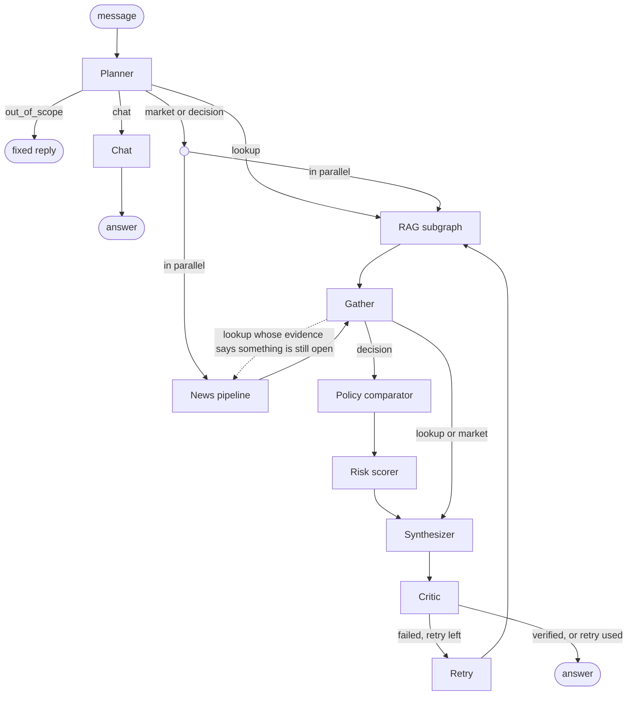

# Company decision-support agent

A RAG-based chat assistant built for employees. It helps the employees to quickly and fully check their ideas/questions with the company internal documents, past projects, policy, risk factors and also with the external data that can be about competitors, market that feeds from news or social media. It is built with LangGraph and runs fully on your own machine: a local Gemma LLM through LM Studio, local embeddings, a local vector store. 

**The company in this project is an example.** The project uses Arla Foods (https://www.arla.com/), a farmer-owned dairy cooperative, because its governing documents are public. The agent itself is not specific to Arla. It can be used for any company, provided you give it that company's internal documents (PDFs and a small metadata file) and name its competitors for the news tool. In the rest of this document "the company" means whichever company the documents belong to; in this repository that is Arla.

## The problem

Someone who joins a company has no memory of how it has acted before. The answers are in documents (annual reports, the code of conduct, the supplier code, the anti-bribery and human rights policies), but there are a lot of them, the same policy often exists in several yearly versions, and finding the right page by hand is slow. The market also moves faster than the documents. A plan that fits the policy can still be a bad idea this week because of a product recall in the news. And a wrong answer about policy can mean a compliance breach, so an answer has to be cited and easy to check.

The assistant handles three kinds of question:

| Kind | Example | What it does |
|---|---|---|
| lookup | "What was the company's revenue in 2024?" | Finds the passage and answers with citations and the exact quote |
| market | "What is the latest news about the company?" | Adds recent news, sentiment and events for the company and three competitors |
| decision | "Should we accept a EUR 300 gift voucher from a supplier during a tender?" | Checks the plan against policy and gives a risk level with reasons |

It also remembers the conversation, so "and in 2023?" works as a follow-up.

Why an agent and not a plain retrieve-and-answer pipeline? Because the questions need different tools (only decisions need the policy and risk checks), a comparison like "2023 versus 2024" needs two separate searches, evidence can be missing or out of date, and a small model will sometimes invent a number. The agent routes, splits, retries and checks.

The goals were: cited answers, awareness of newer sources and current news, a transparent second opinion on a plan, and an honest "I could not find this" when the documents do not say.

## How it works



How to read it: the planner picks exactly one intent per message. A **lookup** goes to the RAG subgraph only. A **market** or **decision** question needs both document evidence and news, so the two run at the same time (the small circle is the split) and meet again at Gather. The dashed arrow is the one exception: a lookup whose answer says something is still pending ("expected to", "not yet") also gets the news added.

- **Planner.** One LLM call decides the intent, splits a compound question into parts and, in a chat, rewrites a follow-up into a standalone question. Clear "should we / can we" questions are caught by a rule first (see Results).
- **RAG subgraph.** A separate graph that finds and cites passages (next section). Parts of a compound question run in parallel.
- **News pipeline.** Google News headlines for the company and three competitors (Lactalis, FrieslandCampina, Danone; these are example competitors for Arla), cleaned and de-duplicated, sentiment scored with a local FinBERT model, and flagged for events such as recalls. No LLM is involved.
- **Policy comparator and risk scorer.** Described below.
- **Critic.** Checks citations, that every figure appears in the cited text, and that the quote is really there. On failure it retries once with wider retrieval, and if it still fails the answer carries a visible warning.

Choices worth explaining:

- **The LLM writes, code decides.** Verdicts are validated, the risk level cannot be changed by the model, and the sections of an answer are built by code. The model only writes language.
- **A small local model (Gemma 4 E4B).** No paid API was the rule, and it runs on ordinary hardware. The price is speed: about 16 tokens a second.
- **A news snapshot, not live news.** The external (new) data is a dated snapshot (30 October 2026) so results can be reproduced and the container works offline.
- **The LLM stays outside Docker.** The container talks to LM Studio on the host, so the image does not have to carry a model.

### The RAG subgraph

The RAG part is its own LangGraph graph, called from the main graph through a wrapper node. Its steps: **rewrite** the question into a short search query and a year, **retrieve**, **grade** the result, then **generate** a cited answer. If grading fails it rewrites once more with different keywords. Grading uses the retrieval distance first (at most 0.30 is relevant, above 0.45 is not) and asks the LLM only in between. If the evidence is missing, the answer is "I could not find this in the documents."

Every design choice below was tested rather than assumed.

| Decision | What was tested | Outcome |
|---|---|---|
| **Data quality** | A check of all 22 PDFs: broken glyphs, letter ratio, empty pages, ligatures, hyphenated line breaks, repeated headers | All were readable. Cleaning removes repeated headers and footers, rejoins hyphenated words and normalises ligatures. |
| **Metadata** | Deriving type and year from file names | Wrong or missing years for several files, so metadata is an explicit, hand-checked `manifest.csv` |
| **Chunking** | Recursive (800 characters, 150 overlap) against parent-child (small 300-character children are matched, the larger 1,500-character parent is shown to the model). Both are cut per page so page numbers in citations are exact. | Parent-child ranks better: hit@1 0.65 against 0.55, MRR 0.76 against 0.70. At hit@5 both reach 0.90. |
| **Embeddings** | `bge-small` (130 MB) against `bge-base` (three times larger) on the same cached queries | Same MRR (0.76). `bge-base` gave no measurable gain, so `bge-small` stays. |
| **Vector store** | Chroma, local folder | No server or key needed, and it supports the metadata filters (year, document type) the search relies on |
| **Year filter** | Raw question, rewritten query, year filter, and combinations (5 query modes, 2 chunkers, 20 questions) | The largest single gain. On figure questions hit@5 rose from 0.50 to 1.00, on multi-year questions from 0.50 to 1.00. |
| **Document-type filter chosen by the LLM** | Same experiment | It hurt: the model guessed the type wrong too often, and a wrong filter is a guaranteed miss (policy hit@5 fell from 0.80 to 0.50). It is not used. The policy tool uses a fixed list of policy types set in code instead. |
| **Prompt size** | An early run crashed with HTTP 400 on a retry (8 long chunks overflowed the context) | A 6,000-character budget, cutting long chunks to a window around the matched passage |

The best setup (parent-child chunks, rewritten query, year filter) finds the right page in the top five for 90% of the 20 test questions. With 20 questions one question is worth 5 points, so the large effects (year filter, document-type filter) are trustworthy and small differences between chunkers are not. One more lesson: figure questions first scored 0.17 because my gold pages were too narrow (the same figure sits on 4 or 5 pages of a report). After checking the PDFs and widening them, the score was 1.00. It was a labelling problem, not a retrieval problem.

### Policy comparator and risk scorer (the non-retrieval tool)

This is the tool that is not plain retrieval. It turns "does the plan break our rules, and how risky is it?" into a verdict and a score. It runs only for decision questions.

**Policy comparator.** It searches only the policy documents (a fixed list of types), keeps the newest version of each and drops weak matches. If nothing is left it answers `no_precedent` without calling the LLM. Otherwise one LLM call picks one of three verdicts: `consistent`, `conflict` or `no_precedent`. Code then checks that the verdict has a real citation. A verdict with no valid citation is downgraded to `no_precedent`.

**Risk scorer.** Plain code, no LLM. Four scores from 0 to 100 (higher is riskier) are combined with fixed weights:

```
risk = 0.40 x policy + 0.20 x regulatory + 0.20 x news + 0.20 x evidence
```

| Score | How it is set |
|---|---|
| Policy | `conflict` 90, `no_precedent` 50, `consistent` 10 |
| Regulatory | How many sensitive legal topics the plan touches. If the plan mentions a topic (for example "gift" or "tender" means bribery), that topic adds points: bribery 40, sanctions 40, human rights 35, food safety 30, competition 25, and so on. The points are added up, and the total never goes above 100. |
| News | How bad the current news is for the company. It looks at how many headlines are negative and whether there are serious events such as recalls. Only news related to the plan counts, so an unrelated recall does not raise the score. If no news is available, the score is a neutral 50. |
| Evidence | How weak the document evidence is. Points are added when the best match is poor, when fewer than 3 passages were found, when the search result was judged not relevant, or when a retry was needed. More points means we should trust the answer less. |

The level is LOW below 35, MEDIUM below 65 and HIGH from 65. A hard floor keeps any `conflict` with an anti-bribery, human rights, supplier-code or modern-slavery policy at MEDIUM or above. The output also lists the top drivers and a mitigation for each. All weights and thresholds are in `config/risk.json`, and 12 unit tests cover the scorer. The weights are expert-set, not learned, so the score is a transparent decision aid and not a prediction. Example: the EUR 300 voucher during a tender scores policy 90, regulatory 40, news 7, evidence 0, total 45.5, so MEDIUM.

## Results

### How the evaluation set was built (`eval_agent.py`, 20 questions, real model)

The set is organised so that every route of the graph is exercised, and each route has questions that can fail in a different way.

| Route | Questions | What they test |
|---|---|---|
| lookup | 8: six single facts and two comparisons ("2023 versus 2024") | Retrieval, the year filter, citations, and splitting a question into parallel parts |
| market | 4 | The news branch running next to RAG |
| decision | 5: four conflicts and one allowed case | The policy comparator and the risk scorer, with both outcomes of the verdict |
| out_of_scope | 3 | The early exit, with no search and no news |

The chat route (questions about the conversation) and follow-ups are covered by unit tests with a stubbed LLM, not by this set. Each question has a label for the expected route and keywords the answer must contain, and decisions also have an expected verdict.

| Measure | Result |
|---|---|
| Routed to the right path | 19 of 20 |
| Correct answer | 19 of 20 |
| Correct policy verdict | 5 of 5 decisions |
| Passed the critic without a warning | 17 of 20 |

**What the small model could not do.** In the first full run the local model did not recognise a single decision question as a decision. It labelled all five as lookups, so the policy check and risk score never ran, and rewording the prompt did not help. The fix is a regular expression for clear phrasings ("should we", "can we", "is it OK to", "we are considering"), applied before the LLM. This is a workaround for the small model. A larger, production-grade LLM is expected to classify these questions reliably from the prompt alone, and the rule could then be dropped or kept as a cheap shortcut.

Each of the first two measures has one miss, and they are different questions, so two questions are affected in total. The answer-correctness miss: the half-year performance price came back w
rong (51.4 instead of 43.6). That question was routed correctly, but the critic cannot catch the error: it proves the number exists in the text, not that it answers the question. The routing
miss: "who are the company's competitors" went to the chat path instead of the market path. The answer was right, but my label said market, so it counts against routing only.

Other tests:

- Retrieval, 20 questions: hit@5 of 90%, MRR 0.76 (table above).
- Policy comparator, 12 cases: all 12 verdicts correct, and the expected policy was cited in the 10 cases that have one.
- 84 unit tests pass without an LLM (`python -m pytest tests`).

### How fast is it? (`load_test.py`)

A real-model run of 50 to 200 queries would take hours on one local model, so the test has three parts.

| Run | What | Result |
|---|---|---|
| A | 100 queries, dummy LLM (everything except the LLM) | 0.06 s per query on average, p95 0.13 s |
| B | 12 queries, real model, one at a time | 126 s on average, p95 238 s |
| C | Estimate for 50 / 100 / 200 real queries | about 1.7 / 3.5 / 7 hours |

Run B by route: single-fact lookups 60 to 130 s, market 162 s, decisions 145 s, out-of-scope questions 40 s. Run C is an order of magnitude only, because run B has just 2 to 4 queries per route.

**The bottleneck is the LLM.** Without it a query costs well under a second. With it, generation speed (15 to 17 tokens a second) decides everything. Running queries in parallel does not help either: even without the LLM, eight at once only raised throughput by 3% (each query got about eight times slower), and one local model serves one request at a time anyway. The model also writes far more than it needs to: a query rewrite should be about 30 tokens of JSON but averages about 350.

Two ways to speed it up, not yet done:

1. Cut the output of the short JSON steps (rewrite, planner, grade). They are about 40% of the LLM time. I did not do it because a hard token cap could cut off the model's hidden reasoning, and the planner would then fall back to lookup and mis-route questions. It has to be checked against the 20-question evaluation first.
2. Cache LLM replies. They are deterministic at temperature 0, so a repeated prompt costs nothing. I did not do it because the test questions are all different, so the load test would not show a gain. It helps in real use, where questions repeat.

## Run it

### With Docker

You need Docker Desktop and LM Studio.

1. In LM Studio, load `google/gemma-4-e4b` and start the local server (it listens on port 1234). A context length of 8192 or more is best.
2. Clone the repository and run:

```
docker compose up --build
```

3. Open http://localhost:8501.

The first build takes about 13 minutes and the image is 4.3 GB: it installs the dependencies, downloads the two small models and builds the search index from the PDFs. After that the container needs no internet.

- No LM Studio? `LLM_BACKEND=dummy docker compose up --build` runs the whole pipeline and UI with canned LLM replies.
- Port 8501 busy? `APP_PORT=8502 docker compose up`.
- Different model or server: set `LLM_BASE_URL` and `LLM_MODEL`.

### Without Docker

Python 3.10, LM Studio running as above.

```
python -m venv venv
venv\Scripts\activate
pip install -r requirements.txt
python ingest.py            # builds the search index, a few minutes
streamlit run app.py
```

### Changing the LLM

The model is chosen with three environment variables. No code change is needed.

| Variable | What it does | Default |
|---|---|---|
| `LLM_MODEL` | The model name. It must match the name LM Studio shows for the loaded model. | `google/gemma-4-e4b` |
| `LLM_BASE_URL` | The address of the LLM server. | `http://localhost:1234/v1` (in Docker `http://host.docker.internal:1234/v1`) |
| `LLM_BACKEND` | Set to `dummy` to use canned replies and no real LLM. | unset |

To use a different LM Studio model, load it in LM Studio, start the server, and set `LLM_MODEL` to its name. Any other server with an OpenAI-compatible API also works if you set `LLM_BASE_URL` as well.

With Docker (the variables go in front of the command):

```
LLM_MODEL=<name in LM Studio> docker compose up
LLM_BACKEND=dummy docker compose up --build
```

Without Docker, in PowerShell (use `export VAR=value` on Linux or macOS):

```
$env:LLM_MODEL = "<name in LM Studio>"
streamlit run app.py
```

For the dummy LLM, use `$env:LLM_BACKEND = "dummy"`. The defaults are in `rag/llm.py` and `docker-compose.yml`.

### Using another company

Put the company's PDFs in `corpus/`, describe each one in `corpus/manifest.csv` (id, file, title, document type, year, url), rebuild the index with `python ingest.py`, and change the company and competitor names in the news settings. The graph, the RAG subgraph and the policy and risk tools do not change.

### Other commands

```
python run_agent.py "What was the company's revenue in 2024?"   one question, with the route and timings
python eval_agent.py          the 20-question evaluation (about 45 minutes, resumable)
python eval_policy.py         the policy comparator evaluation
python compare_retrieval.py   the retrieval experiments
python load_test.py a         load test with the dummy LLM (b: real model, c: estimate)
```

## Limits

- It is slow. A typical question takes two minutes or more, and the planner alone takes about 30 seconds.
- Numbers in financial tables are the weak spot, because the tables lose their structure when the PDFs are read.
- The decision rules cover clear phrasings such as "should we" and "is it OK to". An unusual phrasing depends on the small model, which was not good at this.
- The evaluation sets are small and I wrote the labels myself.
- The news is a snapshot, and sentiment is scored on headlines only. FinBERT measures financial tone, not risk to the company.
- The risk weights are set by hand, not learned.

## What I would do without the time and resource limits

The choices above were shaped by a few weeks of work and one ordinary machine. With more of both, these are the changes I would make, in rough order of value.

1. **A bigger, production-level LLM.** A larger model (a hosted frontier model or a 30B+ open model on a GPU) would remove most of the weak spots at once: it would classify decision questions without the regular expression, read financial tables more reliably, keep citations in every sub-answer, and generate many times faster. Latency would drop from minutes to seconds, and the load test could then run the full 50 to 200 queries against the real model.
2. **Compare more designs, with bigger evaluation sets.** I tested two chunkers and two embedding models on 20 questions. I would add hybrid search (keyword plus vector), a cross-encoder reranker, more embedding models, other chunk sizes, and a self-check step where the model rechecks its own answer. I would build 100+ questions, labelled by more than one person, so that small differences become measurable and the labels are not only my own.
3. **Better handling of tables.** Use table-aware PDF extraction for the financial statements, which would address the main source of wrong numbers.
4. **A model-based decision classifier and an answer judge.** Replace the regular expression with a dedicated short classification call, and add an LLM judge that checks whether a figure actually answers the question, which the current critic cannot do.
5. **Live news with article text. (and addition of social media scraper API)** Use a real news API that returns article bodies, score sentiment on the text rather than the headline, and tune a model for risk to the company instead of financial tone.
6. **Learn the risk weights.** Fit the scorer's weights from reviewed past decisions, with feedback from compliance staff, instead of expert-set values.
7. **Product features.** Stored conversations, document upload with automatic re-indexing, user accounts, and a newest-version preference when a question names no year.

## Where things are

`agent/` the graph, planner and nodes. `rag/` the RAG subgraph, chunking and index. `news/` the news pipeline. `tools/` the policy comparator and risk scorer. `corpus/` the 22 PDFs and `manifest.csv`. `eval/` the question sets and results. `tests/` the unit tests. `app.py` is the UI.
